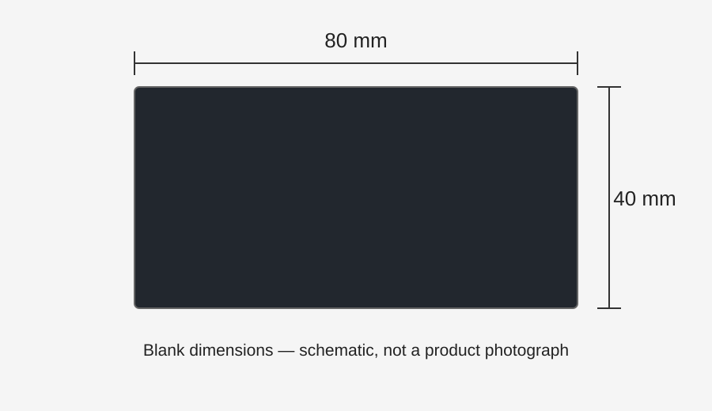
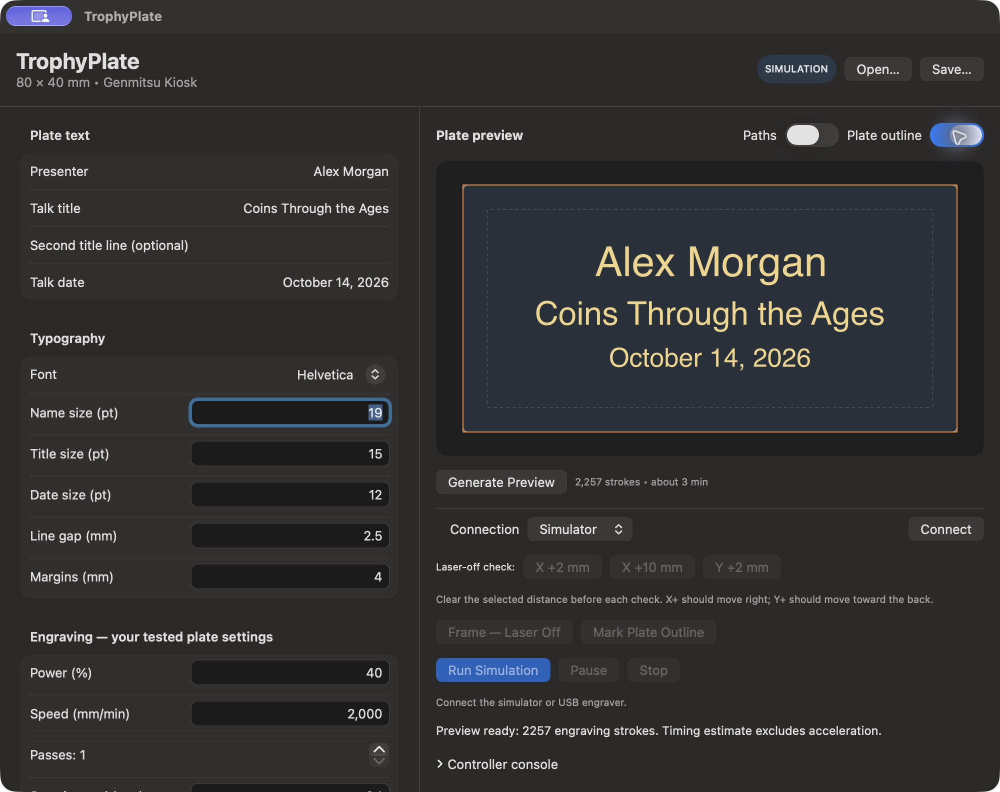
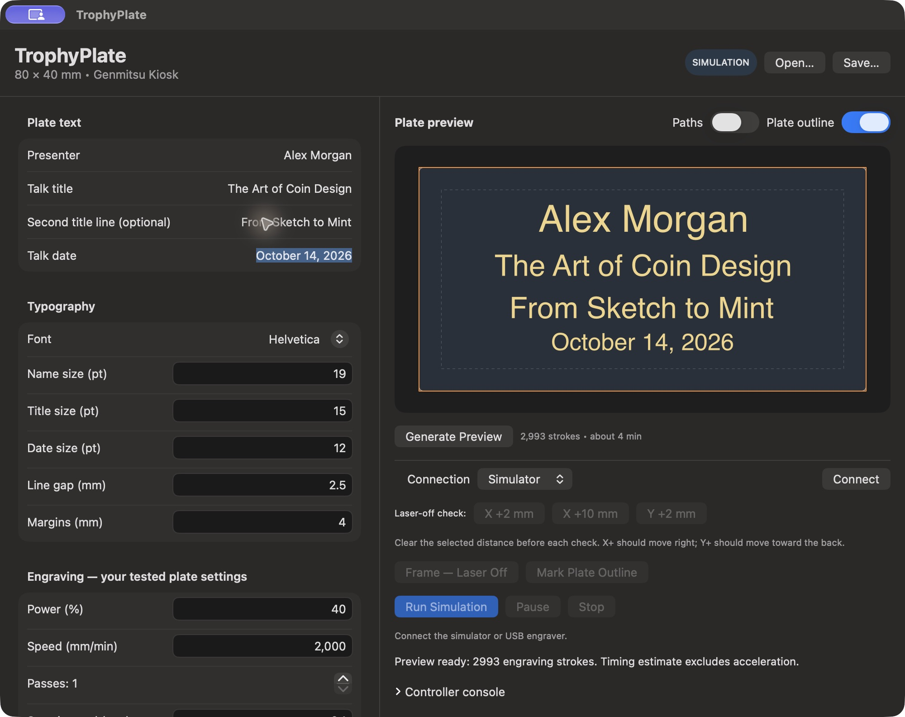
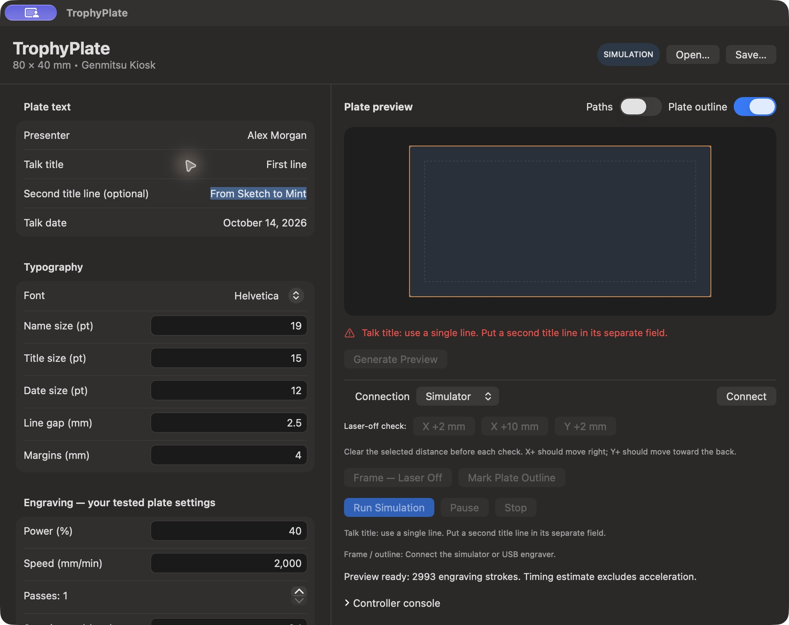

# TrophyPlate user guide

TrophyPlate designs and engraves centered **80 × 40 mm trophy plates** on macOS 14 or later. It was developed with a Genmitsu Kiosk 5 W, 455 nm diode laser and a 100 × 100 mm working area. USB is supported; Wi-Fi is not implemented.

## What you need

- An Apple Silicon Mac running macOS 14+ (the development machine uses an M4).
- The Kiosk, its power adapter, a working USB data cable, and laser-suitable coated-metal blanks.
- A stable backing board, the manufacturer's focus tool/procedure, suitable protection and ventilation, and an attended work area.
- An 80 × 40 mm blank: the owner supplied [this Amazon plate listing, ASIN B08H6V8CHJ](https://www.amazon.com/dp/B08H6V8CHJ?th=1). Verify the selected variant's dimensions, coating and suitability for diode-laser engraving before ordering. The listing could not be independently retrieved when this guide was written; no price, alloy, thickness or coating specification is assumed here.



The tested process removes a coating to reveal contrasting text. It does not cut through the metal. The screen's gold lettering is a preview color; the actual finish depends on your blank.

## Build and launch

Install Xcode or Apple's command line tools, then run:

```sh
git clone https://github.com/g4goza/trophyPlate.git
cd trophyPlate
swift test --disable-sandbox
./scripts/build-app.sh
open build/TrophyPlate.app
```

The app is locally ad-hoc signed, not notarized. It has no third-party package dependencies. Source and contribution details are in the [README](../README.md); test coverage and hardware limits are in [TESTING](../TESTING.md).

## Design a plate without hardware



*Actual app screenshot in Simulator mode. Alex Morgan is fictional example text. The plate is a digital layout preview, not a photograph of an engraving.*

1. Enter **Presenter**, **Talk title**, and **Talk date**. Leave **Second title line** empty for three lines; fill it for four lines.
2. Text is centered horizontally and the whole block vertically within the 80 × 40 mm plate. Adjust name, title and date sizes independently. The two title lines share a size.
3. The text preview updates as you edit. Engraving paths regenerate automatically after a short pause; **Generate Preview** also regenerates them manually. This never starts the laser.
4. Boundary whitespace is trimmed when leaving a text field; pasted leading/trailing line breaks are removed immediately. Internal line breaks remain an error, with the affected field identified. Put a second title line in its own field.
5. Reduce font size or shorten text if it exceeds the margins. There is no silent auto-shrink or automatic wrapping. Color emoji and glyphs without usable outlines are rejected rather than silently omitted.
6. **Plate outline** overlays the orange plate boundary while keeping text visible. **Paths** displays the generated scan strokes; both switches may be on together. Display switches do not add an outline to a text engraving job.
7. Choose **Simulator → Connect**, then **Run Simulation** to exercise the job controls without hardware. The simulator acknowledges commands; it does not model motion, material finish or real engraving time.
8. **Save** writes a JSON design. **Open** restores text, typography, placement and material settings. Connection and placement confirmations are deliberately not saved.



*A four-line digital example: presenter, two title lines and date. These screenshots show what the app will lay out; they do not predict coating color or engraving quality.*

## Connect over USB

1. Use the Kiosk's **USB-PC** port with its normal power adapter. Close LightBurn, CutLabX and other serial applications.
2. Use a verified data cable. On the development Mac, USB-C-to-C attempts did not enumerate the device; a USB-A-to-C data cable through a Mac adapter worked. Accept macOS's accessory prompt when shown.
3. Select **USB**, refresh ports, choose the detected serial port and click **Connect**. The owner's port was `/dev/cu.usbserial-210`; yours may differ.
4. The app connects at 115200 baud and checks GRBL identity, Idle status, laser mode `$32=1`, power scale `$30`, and millimeter position reporting `$13=0`. It reads these settings; it does not silently rewrite firmware.
5. The owner's firmware reported `1.3a.20211103`, `$30=1000`. Compatibility with other firmware is not assumed.

Connection does not home the head or establish physical zero. Opening a saved design does not commission a new setup.

## Establish plate placement

With the head's travel clear, test **X +2 mm**, then **Y +2 mm**, one at a time. **X +10 mm** is available for a more visible check. These moves use 120 mm/min and force laser power off. On the tested Kiosk, positive X moves right and positive Y moves toward the back, viewed from the front.

The plate's left X and bottom Y are coordinates in the controller's work coordinate system. New designs default to X=10, Y=30, which centers an 80 × 40 mm plate in the assumed 100 × 100 mm workspace. These defaults are not a substitute for verifying your machine's origin.

After verifying origin, directions, and placement, check the placement confirmation and use **Frame — Laser Off**. It traces the 80 × 40 mm boundary and returns to the **plate corner**, which need not be machine X=0, Y=0.

**Power-cycle behavior observed on the owner's Kiosk:** the head stayed physically still while the controller reset its position counters to zero. Keep the board and machine fixed; after a power cycle, reconnect and re-establish the physical reference before any job. Never assume reported zero means the head is at the front-left machine corner. The owner's subsequent setup deliberately used the verified current head location as the plate corner, with plate offsets X=0, Y=0; do not copy those offsets without verifying your own setup.

Before every physical job, the app checks fresh machine position, work offset and power scale against its snapshot. An unexpected change blocks the job. This cannot detect a shifted board or every physical disturbance.

## Mark a reusable board guide

1. Verify placement using laser-off framing first.
2. Remove the metal blank and focus on a laser-suitable backing board.
3. Set the separate **Board outline** power and speed. Click **Mark Plate Outline**, review the laser-on confirmation and explicitly start it.
4. After completion, keep the board, machine and coordinate reference fixed. Place each blank inside the marked rectangle and refocus on the metal's top surface.

Outline controls are separate from text controls. Initial outline settings are 10% and 2,000 mm/min, one perimeter pass. The owner's pine guide became visible after cumulative passes at 10%, 20% and 30%; that does **not** establish a single-pass 30% wood preset. An outline job marks only the rectangle; a text engraving job marks only the text.

## Engrave coated metal

| Setting | Owner-tested starting value |
| --- | --- |
| Text power | 40% |
| Speed | 2,000 mm/min |
| Passes | 1 |
| Scan interval | 0.10 mm |

The owner approved these results on their tested blanks and focus setup. The app labels an exact match as tested settings; any changed value is labeled custom. These are starting values for another user's material, not a universal coating preset. Test on a spare blank first.

1. Check spelling, date, orientation and all visible lines in the preview.
2. Position the blank inside the verified guide; focus on the top of the blank.
3. Confirm placement and that the settings were tested on this plate material. Keep the machine attended with its protective measures in place.
4. Click **Engrave Plate** explicitly. Auto-preview never starts a physical job.
5. Wait for **Controller reports Idle — job complete** before replacing the plate. Accepted command count can reach 100% while buffered movement is still executing.
6. For the next plate, edit the text, inspect the refreshed preview and replace the blank. Text edits preserve placement/material confirmations; changing X/Y clears placement, and changing text power/speed/passes/interval clears material confirmation. Reconnecting or opening a file clears both.

**Pause/Resume** controls an active job. **Stop** requests feed hold and controller reset, closes USB and requires reconnection. Software Stop is best effort; use physical controls if needed. Hardware pause/stop and cable-loss acceptance are still pending controlled testing. Interrupted jobs never automatically resume or replay.

## Troubleshooting

| Symptom | What to check |
| --- | --- |
| Preview button disabled | Read the validation message or nearby reason. Wait for generation/connection, finish an active job, or correct the identified field. |
| A text field says single line | Remove internal line breaks. Leading/trailing pasted breaks are cleaned automatically; use the separate second title field. |
| Text does not fit | Reduce the affected size or shorten the title. Increase available space only within the plate's valid margins. |
| Outline hides the text | In version 0.5+, outline is an overlay. Update older versions that show outline instead of text. |
| Engrave disabled | Connect, wait for a valid preview, obtain valid coordinates, and complete placement/material confirmations. A nearby message identifies the next requirement. |
| Frame/mark disabled | Connect, verify valid placement coordinates and confirm placement. Board outline settings must also be valid for marking. |
| No USB port | Check power, USB-PC port, accessory permission and a known data cable; refresh the list. Try the cable/adapter arrangement above. |
| Port busy or connection fails | Exit other serial tools, reconnect and inspect Controller console. |
| Position/work offset/power changed | Stop and investigate the physical reference or controller setting. Reconnect and re-establish placement; do not bypass the check. |
| Simulator completes very quickly | It does not reproduce physical motion timing. Preview estimates also exclude acceleration and buffering. |
| Software stops after a controller error | Reconnect only after assessing the head, blank and reference. There is no automatic job replay. |



*The editor identifies the field containing an internal line break. The second title belongs in its separate field.*

## Current limits

Fixed 80 × 40 mm plate and assumed 100 × 100 mm work area; text-only raster engraving; USB GRBL transport. No Wi-Fi, camera alignment, logos, automatic homing, general-purpose jogging, automatic text fitting or CSV batches. Material results and coordinate directions were validated on one owner's setup. See [TESTING](../TESTING.md) for the acceptance checklist and known limitations.
